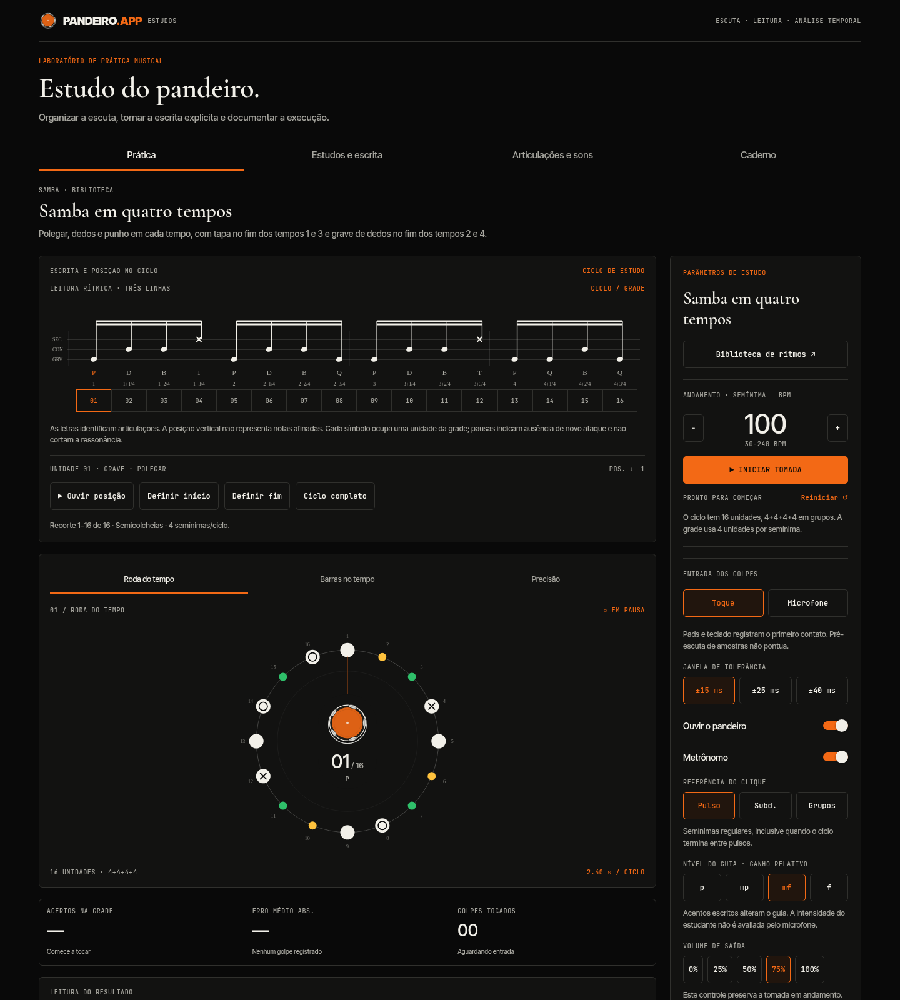

# PANDEIRO.APP — Estudos de percussão

Laboratório de estudo do pandeiro em React Native / Expo SDK 54. A versão **1.1.0** organiza leitura rítmica, articulações, amostras reais e documentação de tomadas. O foco é precisão de escrita, escuta comparativa e análise temporal, com ferramentas úteis à formação em percussão de concerto.

Os 148 ritmos tradicionais mantêm os seus contextos e referências. Os oito estudos técnicos são propostas originais do projeto; não são transcrições de obras eruditas ou de métodos. A aplicação não substitui revisão por professor e não certifica técnica instrumental.

## Experimentar sem instalar dependências

Instale Node.js LTS, extraia o ZIP e abra um terminal na pasta que contém `package.json`:

```sh
npm run preview
```

Acesse **http://localhost:8080**. Deixe o terminal aberto; Ctrl+C encerra. Para atualizar de uma versão antiga, encerre o servidor, extraia em outra pasta, inicie novamente e recarregue com Ctrl+F5. O rodapé mostra a versão.

## Áreas do laboratório

- **Prática:** escrita em três linhas, inspeção de unidades, recorte para repetição, roda, barras e gráfico de erro. Permite isolar uma articulação, ajustar a referência sonora e registrar um resumo da execução.
- **Estudos e escrita:** oito exercícios de silêncio, alternância, acentos, tercinas, sextinas, 6/8 e 2+2+3. Editor de 1 a 32 unidades, com validação de letras e agrupamento aditivo. O rascunho é preservado ao navegar entre áreas durante a sessão.
- **Articulações e sons:** nove famílias e 43 gravações isoladas. Pré-escuta, escolha de amostra por articulação, descrição do contato, questões de escuta e limites de identificação.
- **Caderno:** até 50 resumos locais com observações. Exporta a tomada atual em JSON/CSV, atualiza o mesmo registro sem duplicá-lo, permite desfazer remoção e oferece recuperação dos dados brutos quando o armazenamento contém conteúdo ilegível.

A interface usa tipografia serifada para títulos, texto sem serifa para leitura e monoespaçada para dados. Navegação de teclado e estados de seleção têm atributos acessíveis explícitos na web. A leitura musical pode ser rolada horizontalmente em telas pequenas.



Outras telas: [estudos e editor](docs/images/estudos.png), [atlas sonoro](docs/images/atlas.png), [caderno](docs/images/caderno.png) e [celular](docs/images/celular.png). O registro mostrado no caderno é um exemplo de conferência da interface, sem avaliação de um estudante.

## Unidades musicais: o que o app assume

**O BPM é sempre referido à semínima.** A subdivisão informa quantas unidades iguais cabem em uma semínima:

| Unidades por semínima | Leitura da grade          |
| --------------------- | ------------------------- |
| 2                     | Colcheias                 |
| 3                     | Tercinas de colcheias     |
| 4                     | Semicolcheias             |
| 6                     | Sextinas de semicolcheias |
| 8                     | Fusas                     |

`duração da unidade = 60 / BPM / subdivisão`.

**Ciclo não é sinônimo de compasso.** Um ciclo de sete semicolcheias dura 1,75 semínimas e não recebe automaticamente uma fórmula de compasso. A biblioteca identifica a origem da grade; alguns valores são inferidos das descrições ou adotados como grade operacional. O estudante pode reinterpretá-los. Fórmulas de compasso aparecem nos estudos originais em que foram explicitamente definidas.

O agrupamento aditivo também é independente: em 7/8, sete colcheias podem ser agrupadas como 2+2+3. Em 6/8, os dois grupos de três colcheias correspondem a semínimas pontuadas; a referência numérica do campo BPM continua sendo a semínima.

### Três referências de clique

- **Pulso:** semínimas regulares, mesmo que a volta do ciclo caia entre dois pulsos.
- **Subd.:** cada unidade da grade, com indicação diferenciada da semínima.
- **Grupos:** início de cada grupo do ciclo; os intervalos podem ser diferentes, por exemplo 2+2+3.

O buffer fecha simultaneamente o ciclo escrito e a fase da semínima por meio do mínimo múltiplo comum quando necessário. Em sete semicolcheias a 100 BPM, o ciclo dura 1,05 s e o buffer contém quatro ciclos (4,2 s). O clique continua a cada 0,6 s. Isso evita tanto a pausa do player HTML corrigida em 1.0.1 quanto um reinício artificial da pulsação em ciclos fracionários.

## Notação e articulações

A escrita em três linhas é **uma convenção didática própria**. A posição vertical indica famílias de articulação, sem equivalência a altura afinada ou frequência em Hz. As letras desambiguam os nove sons. Os símbolos não reproduzem os sistemas de Luiz Almeida da Anunciação ou Carlos Stasi.

| Código | Vocabulário do catálogo           | Família                           |
| ------ | --------------------------------- | --------------------------------- |
| P      | Grave solto de polegar            | Membrana / graves                 |
| A      | Grave abafado                     | Membrana / graves                 |
| Q      | Grave de dedos                    | Membrana / graves                 |
| D      | Pontas dos dedos                  | Condução                          |
| B      | Base da mão, chamada punho no app | Condução                          |
| M      | Médio, rótulo dos arquivos MEDIO  | Identificação técnica a confirmar |
| T      | Tapa de mão                       | Ataque seco                       |
| X      | Tapa de polegar                   | Ataque seco                       |
| R      | Rulo gravado                      | Textura                           |
| .      | Ausência de novo ataque           | Pausa da grade                    |

Cada unidade tem a mesma duração na grade. Uma pausa não corta automaticamente a ressonância do sample. Rulo é uma textura gravada; a captura atual não avalia a regularidade de um rulo executado. M não é apresentado como uma identificação anatômica confirmada. O app não mede afinação, altura temperada ou qualidade artística do timbre.

## Referência sonora

Os 43 M4A de golpes isolados são preservados em `assets/samples/`. O clipe longo não identificado `a.m4a` foi retirado da distribuição do app; continua no ZIP original enviado pelo usuário.

- **Reprodução:** variantes mono em 44,1 kHz, recorte do silêncio inicial, referência de pico 0,8 e fade final de 12 ms. As caudas não são limitadas artificialmente a 500 ms. Origem, número de frames, duração e recorte constam no catálogo.
- **Análise de timbre:** banco separado em 16 kHz. A taxa efetiva da captura, quando disponível, aparece na calibração e nos dados exportados.
- **p / mp / mf / f:** ganhos relativos aplicados ao guia. Acentos escritos aumentam o ganho de referência. Esses controles não simulam camadas acústicas de dinâmica nem medem intensidade em dB SPL.
- **Volume de saída:** muda o volume sem zerar a tomada. A configuração exportada é um retrato do estado final; o volume pode ter variado durante a execução.

Escolher outra amostra, escrita, recorte, clique, nível do guia ou compensação de captura inicia outra tomada. Reaplicar um estudo também cria uma tomada independente, mesmo quando as notas coincidem. Registre o resumo ou exporte os eventos antes de alterar esses parâmetros.

## Medidas e microfone

Os golpes vêm de pads, teclado ou captura. Não há eventos de aluno simulados.

```ts
{ t, nominal, kind, source?, confidence? }
// t e nominal: segundos no relógio da reprodução
// erro_ms = 1000 * (t - nominal)
```

A associação usa a unidade mais próxima. Um acerto exige articulação correta e erro dentro da janela escolhida, uma vez por posição concluída. MAE é o erro médio absoluto; σ é o desvio-padrão populacional dos erros; o viés é a média com sinal. As métricas temporais incluem todos os golpes registrados, inclusive os de articulação divergente. O diagnóstico de ausência, articulação divergente, erro temporal, golpe em pausa e repetição usa categorias que podem se sobrepor.

Essas medidas descrevem **ajuste local à grade**. Não identificam de maneira geral um deslocamento inteiro de frase e não constituem uma avaliação de interpretação musical.

A captura é experimental. O detector usa envelope de 2 ms, janela de timbre de 40 ms, intervalo mínimo entre ataques de 65 ms e referências espectrais. A medida de cruzamentos de zero é normalizada pela taxa da captura. O índice de semelhança é heurístico, sem significado de probabilidade calibrada.

Para calibrar, selecione Microfone, use fones e abra a articulação desejada em **Grade, fontes e calibração**. Toque três ataques isolados e selecione a letra novamente para concluir. Até oito exemplos por classe ficam na sessão. O guia e o clique são desligados ao ativar a captura, para reduzir a realimentação pelo alto-falante; o clique pode ser ligado com fones.

A compensação manual desconta um atraso fixo configurado. Não há certificação de precisão física de ±15 ms, alinhamento automático de latência, taxa de reconhecimento medida em alunos ou avaliação validada de dinâmica, rulos e golpes sobrepostos. Erros do classificador podem aparecer como desacordos musicais; confirme a execução por escuta e observação externas.

Na web, o microfone requer HTTPS ou localhost e AudioWorklet. No celular, requer development build. Permissões e callbacks de tentativas canceladas são isolados, e a captura é encerrada ao voltar para Toque ou sair do app. A pré-escuta não funciona durante a captura, evitando contaminar a análise.

## Caderno e exportação

O caderno guarda **resumos e observações**, sem áudio ou eventos individuais de tomadas antigas. Para preservar os golpes de uma execução, exporte a tomada atual antes de mudar sua configuração.

- JSON: escrita original, recorte, configuração final, amostras, observações, unidades, resumo e todos os golpes da tomada atual.
- CSV: um golpe por linha; t e nominal em segundos, erro em ms, código, origem e índice heurístico. Usa UTF-8 e vírgulas conforme RFC 4180. No Excel, importe escolhendo UTF-8 e separador vírgula.
- Mesmo identificador de tomada em CSV, JSON e resumo salvo. Salvar novamente atualiza o resumo, sem duplicá-lo.
- Falhas de leitura ou espaço não apagam os dados existentes. Um caderno ilegível pode ser exportado como texto de recuperação.
- O armazenamento é local ao navegador/origem ou ao app nativo. Limpar os dados do navegador pode apagá-lo. Faça exportações externas; não há nuvem ou importador de cadernos nesta versão.
- Na web, o arquivo é baixado; no Android/iOS, o compartilhamento nativo usa arquivos de cache via expo-sharing.

Leia o [guia de estudo](docs/GUIA_DE_ESTUDO.md) para um protocolo de comparação de tomadas e os [critérios de validação](docs/VALIDACAO.md) para as verificações e limites.

## Desenvolvimento

Node.js 20.19+ ou 22 LTS:

```sh
npm install
npm run typecheck
npm test
npm run web
```

Expo web: http://localhost:8081. Para pads no Expo Go: `npm start -- --go`.

```sh
npm run android:build
# No macOS com Xcode:
npm run ios:build
```

O módulo nativo de PCM é `@siteed/audio-studio`. A exportação de bundles não equivale à compilação ou instalação de APK/IPA.

```sh
npx playwright install chromium
npm run test:browser
# Linux/macOS: incluir captura de um WAV conhecido pelo microfone virtual
python tools/mic-fixture.py
PANDEIRO_MIC_WAV="$PWD/.test-fixtures/microphone-fixture.wav" npm run test:browser
```

No PowerShell, defina `$env:PANDEIRO_MIC_WAV` com o caminho absoluto. O teste alimenta o dispositivo de captura virtual; o detector real produz os eventos.

Regerar dados: `npm run import:rhythms`. Regerar análise e reprodução: `npm run build:sounds` (exige FFmpeg). Os arquivos derivados já estão incluídos; FFmpeg não é necessário para usar o app. Exportar plataformas: `npx expo export --platform all`.

## Organização do código

```text
App.tsx                       composição das áreas e da tomada
src/music/                    agrupamentos, unidades, articulações e estudos
src/components/               leitura, atlas, editor, caderno e controles
src/audio/                    reprodução, samples, microfone e análise
src/study/records.ts           resumos, diagnóstico, validação e CSV
src/storage/                  persistência e exportação por plataforma
src/hooks/                    sessão e caderno
src/pandeiro-ui-base/          três visualizações e tipos compartilhados
src/data/                     catálogos e bancos derivados
assets/samples/               43 originais isolados
assets/kit-44100/              WAVs de reprodução
assets/kit/                   referências antigas de análise em 16 kHz
tests/                        lógica, áudio e navegação no Chromium
```

Fontes dos ritmos: `ritmos.source.js` e `ritmos-PADBT.json`, preservados dos anexos. Bibliografia sobre sistemas de notação: GIANESELLA, Eduardo F. _O Uso Idiomático dos Instrumentos de Percussão Brasileiros: principais sistemas notacionais para o pandeiro brasileiro_. Música Hodie, v. 12, 2012. [Página da revista](https://revistas.ufg.br/musica/article/view/23359). Os metadados foram conferidos na página editorial; a grafia do app é independente.

Licenças das fontes Inter Tight, JetBrains Mono e Cormorant Garamond em `licenses/`. Dependências mantêm as licenças dos pacotes oficiais. Não há PDFs de métodos ou partituras protegidas distribuídos.
